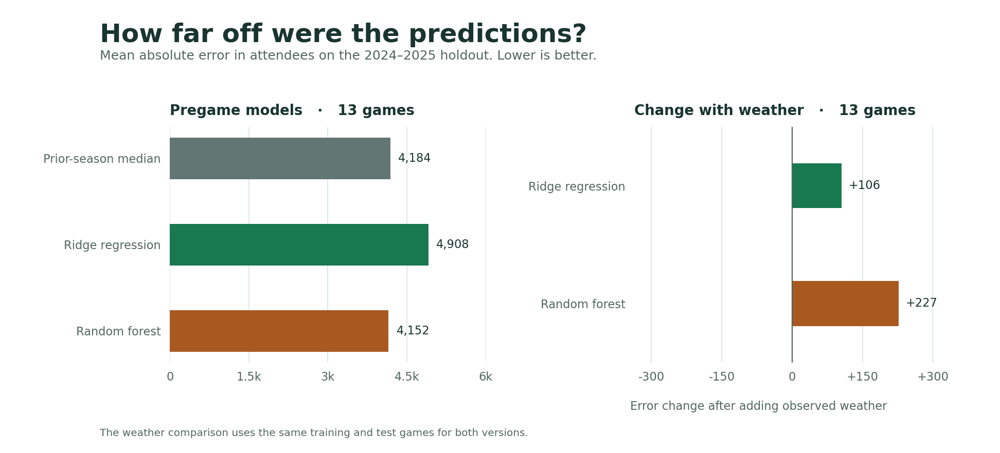

# Michigan State Football Attendance Prediction

Can we estimate reported attendance at Spartan Stadium using the schedule and Michigan State’s record entering the game? This project builds a game-level dataset from public records and compares Ridge regression and a random forest with a simple attendance benchmark.

## 1. Verify the data

- **Game results and attendance.** MSU Athletics publishes a game-by-game results table with the opponent, final score and reported attendance. The project reads the legacy cumulative reports for 2005–2017 and the current season statistics pages for 2018–2025. The 2005 Kent State game, for example, is listed as a 49–14 win with 73,949 in attendance. [MSU statistics archive](https://msuspartans.com/sports/2018/7/20/sports-m-footbl-archivedstats-html) · [2005 cumulative report](https://michstate_ftp.sidearmsports.com/custompages/sports/m-footbl/stats/2005-2006/teamcume.html) · [2025 season statistics](https://msuspartans.com/sports/football/stats/2025)
- **Schedule and stadium.** MSU’s schedule provides game dates, advertised kickoff times, and conference and location information. The study starts with the 2005 stadium expansion and ends with the last complete season as of November 2026. Ford Field games belong to the full schedule but fall outside the Spartan Stadium sample. MSU’s official box score confirms that the September 18, 2010 Notre Dame game took place at Spartan Stadium despite the schedule’s neutral label. [2005 schedule](https://msuspartans.com/sports/football/schedule/2005) · [Stadium history](https://msuspartans.com/facilities/spartan-stadium/12) · [Ford Field announcement](https://msuspartans.com/news/2025/5/30/football-michigan-state-announces-ford-field-ticket-information-for-nov-29) · [2010 box score](https://msuspartans.com/sports/2018/7/25/_m_footbl_stats_2010_2011_nd_msu_html)
- **Weather.** NOAA NCEI’s Local Climatological Data v2 API provides timestamped readings for Lansing Capital City Airport (`USW00014836`). Downloads cover August–December of each season. The join uses the latest qualifying airport report at or before advertised kickoff, within 75 minutes. It interprets NOAA timestamps as fixed local standard time and compares them with Eastern kickoff times on a common UTC timeline. The CSV preserves missing values and identifies reported traces of precipitation. [NOAA LCD v2](https://www.ncei.noaa.gov/products/land-based-station/local-climatological-data) · [LCD v2 documentation](https://www.ncei.noaa.gov/oa/local-climatological-data/v2/doc/lcdv2_DOCUMENTATION.pdf) · [API documentation](https://www.ncei.noaa.gov/support/access-data-service-api-user-documentation)

The two MSU sources reconciled for all **262 completed games**, including **140 at Spartan Stadium**. After excluding four games from 2020, **136** stadium games remained, all with attendance, kickoff time, and a qualifying weather observation. Wind speed was available for 135. The source manifest records the public URL and SHA-256 checksum of each input used for this snapshot. [Data audit](reports/data_audit.json) · [Source manifest](reports/sources.json)

## 2. Build the dataset

The Python pipeline reconciles each schedule with its cumulative results by game date and checks the on-field score and outcome. It sorts the full schedule by season and date, then counts earlier wins and losses before selecting stadium games. For example, an away win changes the record available for the next home game. The record resets every season. This also preserves the information available at the time for games whose wins were later vacated. [MSU and NCAA resolution](https://msuspartans.com/news/2025/11/12/general-ncaa-and-michigan-state-reach-negotiated-resolution)

The modeling cohort uses games at Spartan Stadium with positive reported attendance. The 2020 Big Ten policy limited stadium attendance to a small set of exceptions, including potential family attendance, so those games are kept in the source dataset and excluded from the backtest. [2020 Big Ten policy](https://msuspartans.com/news/2020/9/16/the-big-ten-conference-adopts-stringent-medical-protocols-football-season-to-resume-october-23-24-2020)

The [processed CSV](data/processed/games.csv) has one row per completed MSU football game in scope. The important fields are:

- `game_date`, `season`, `opponent`, `venue`, `is_spartan_stadium`, and `is_conference` identify the game and model scope.
- `attendance` is the reported crowd count. `result`, `msu_score`, and `opponent_score` record the outcome. The models use the derived `prior_wins` and `prior_losses` to represent on-field performance.
- `kickoff_local` includes the Eastern UTC offset, and `kickoff_hour` is the decimal local hour. `weather_observed_at` is UTC. Weather measurements are in °F, mph, and inches.
- `model_eligible` and `model_exclusion` document which rows enter the backtest and why other rows are excluded.

## 3. Compare the models

The baseline predicts the median attendance of the latest available training season. Ridge regression shrinks coefficients for a small dataset with many opponent categories. The random forest averages shallow trees to allow nonlinear relationships. Both use the same schedule and prior-record inputs. Opponent is one-hot encoded, with an unseen opponent handled without fitting on the test set. All preprocessing is fit inside each training split.

For the primary comparison, both the fitted models and the baseline stay fixed across the 2024 and 2025 holdout seasons. The development backtest separately trains on earlier seasons and evaluates the next season. A random game split would let the models learn from seasons in the future. Mean absolute error (MAE) measures the typical size of a miss in attendees. Root mean squared error (RMSE) gives larger misses more weight. [scikit-learn guidance on leakage](https://scikit-learn.org/stable/common_pitfalls.html)

The weather analysis refits each model with and without airport temperature and wind using identical complete-weather rows. Quantitative precipitation was available for 106 games, with 16 additional trace observations. The weather comparison uses temperature and wind for better coverage. The main comparison uses schedule and record features that are available ahead of kickoff.

## 4. Read the results

On the 13 games in 2024–2025, mean absolute error was **4,184 attendees** for the 2023 median, **4,908** for Ridge regression, and **4,152** for random forest. The forest improved on the median by about 33 attendees per game, less than 1%. The median led in 2024, and the forest led in 2025. Across 89 games in the earlier expanding-season backtest, the corresponding MAEs were 2,740, 2,527, and 2,429. [Full metrics, including RMSE and each season](reports/metrics.json)



The forest’s largest holdout miss was the November 30, 2024 Rutgers game. It predicted about 66,297 attendees against a reported 50,038. Adding observed temperature and wind increased holdout MAE by 106 for Ridge and 227 for the forest in the matched comparison. [Game-level predictions](reports/predictions.csv) · [Holdout plot](reports/figures/holdout-predictions.png) · [Attendance history](reports/figures/attendance-history.png)

## 5. Reproduce the project

Run from this directory with Python 3.11–3.13. The project snapshot was generated with Python 3.13.

```bash
python3 -m venv .venv
source .venv/bin/activate
python -m pip install -e .
```

To regenerate the evaluation and figures from the included dataset without downloading the source data:

```bash
python -m msu_attendance evaluate
python -m unittest discover -s tests -v
```

To rerun each step from the public sources, have `curl` available on your PATH. No API token is required.

```bash
python -m msu_attendance fetch
python -m msu_attendance build
python -m msu_attendance evaluate
```

`python -m msu_attendance run` runs those three steps in order. Add `--refresh` to `fetch` or `run` to retrieve new copies of the cached inputs. Source sites can update historical pages. Compare `reports/sources.json` to see which inputs changed. Raw downloads are kept out of version control.

## Limitations

Reported attendance is the metric published by MSU Athletics. The underlying counting method is unspecified in the source records used here. The study covers one stadium and has a small holdout, so a few unusual games can materially change the comparison. The airport measures conditions at its own station. The project uses historical observations for the weather analysis and does not evaluate weather forecasts at a fixed lead time. Rankings were left out of the models because the schedule’s rank labels do not identify a consistent poll series and publication time.
