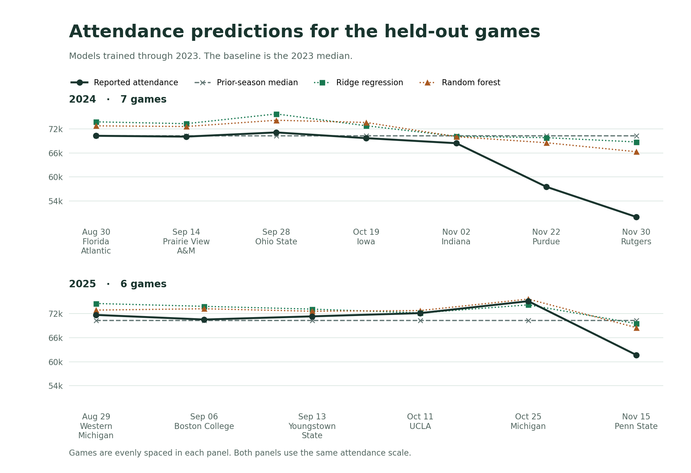

# MSU football attendance prediction

I wanted to see how close I could get to predicting attendance at Spartan Stadium using the opponent, kickoff time, and MSU's record going into the game. The first thing I tried to beat was just guessing the previous season's median attendance.

## What I found

I held out the 2024 and 2025 seasons for the final comparison. Here’s how far off each method was on average over those 13 games:

- **Previous-season median:** 4,184 attendees
- **Ridge regression:** 4,908 attendees
- **Random forest:** 4,152 attendees

The random forest came out ahead by about 33 people per game, which is less than 1%. That’s close enough that I’d call it a wash on this sample. The biggest miss was Rutgers in 2024. The forest predicted about 66,300 and MSU reported 50,038. [Game-by-game predictions](reports/predictions.csv) · [Full metrics](reports/metrics.json)



## Where the data came from

The main file is [games.csv](data/processed/games.csv). MSU Athletics posts schedules and season stats as web pages. The Python code matches those records to get dates, opponents, scores, and reported attendance. NOAA supplies the weather as CSV. I joined each stadium game to the latest qualifying Lansing airport reading at or before the listed kickoff, up to 75 minutes earlier. [MSU statistics archive](https://msuspartans.com/sports/2018/7/20/sports-m-footbl-archivedstats-html) · [2025 season stats](https://msuspartans.com/sports/football/stats/2025) · [NOAA weather data](https://www.ncei.noaa.gov/products/land-based-station/local-climatological-data) · [Source URLs and checksums](reports/sources.json)

The CSV includes 262 MSU games from 2005 through 2025, with 140 at Spartan Stadium. Away games still matter because they count toward the record MSU brought into its next home game. I left the four restricted-attendance games in 2020 out of the models, which left 136 games. Games at Ford Field are outside the stadium sample. [Data audit](reports/data_audit.json) · [2020 attendance policy](https://msuspartans.com/news/2020/9/16/the-big-ten-conference-adopts-stringent-medical-protocols-football-season-to-resume-october-23-24-2020) · [Ford Field announcement](https://msuspartans.com/news/2025/5/30/football-michigan-state-announces-ford-field-ticket-information-for-nov-29)

## What I checked before modeling

Among the 123 games before the holdout, median attendance was 73,522. The middle half of games were between about 71,000 and 75,100. Conference and nonconference games had almost the same median. The rank correlations with pregame winning percentage and kickoff temperature were weak (0.10 and 0.13). I left season openers out of the winning percentage calculation because MSU had no record yet. [Attendance history](reports/figures/attendance-history.png)

## How I tested it

I used SQLite to calculate the record MSU brought into each game. The SQL query groups the full schedule by season, orders it by date, and counts wins and losses from earlier rows only. SQLite runs in memory through Python, so there’s no database to set up. The build writes those features to the CSV that pandas and scikit-learn use for modeling. [SQL query](src/msu_attendance/pipeline.py)

Both models used the same inputs. Those were the opponent, month, Saturday or another day, kickoff hour, conference matchup, and wins and losses entering the game. I trained through 2023 and kept those fits fixed for both holdout seasons. I also ran a separate backtest where I trained on earlier seasons and predicted the next one. Each fit learned its preprocessing from the training games only.

I tested temperature and wind separately on the same set of games with both readings available. They made the average error worse for both models in that comparison. These were observed conditions at the airport, so the experiment doesn’t tell us how a weather forecast would perform. MSU’s reported attendance is also the only crowd measure in the dataset. [Model comparison](reports/figures/model-errors.png)

## Run it

From the project folder, with Python 3.11–3.13:

```bash
python3 -m venv .venv
source .venv/bin/activate
python -m pip install -r requirements.txt
python -m msu_attendance evaluate
python -m unittest discover -s tests -v
```

That uses the included CSV. To download the public inputs and rebuild everything, install `curl` and run:

```bash
python -m msu_attendance run
```

You can also run `fetch`, `build`, and `evaluate` one at a time. Add `--refresh` to `fetch` or `run` to re-download cached sources. If a historical page changes, compare the checksums in the [source manifest](reports/sources.json).
